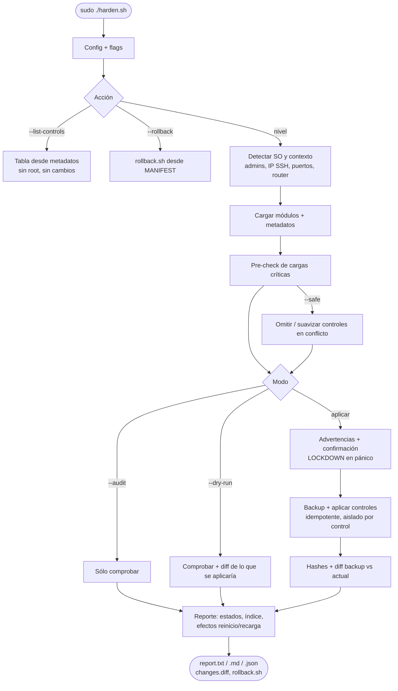

<div align="center">

# 🛡️ linux-hardening

**Hardening de Linux modular, por niveles y reversible, en Bash puro.**
Audita, previsualiza con diffs, aplica con backup y deshaz con un comando.

[](LICENSE)
[](https://www.gnu.org/software/bash/)
[](https://github.com/Josue-Quiroa/linux-hardening/actions/workflows/shellcheck.yml)
[](CHANGELOG.md)
<br>
[](#distribuciones-soportadas)
[](#distribuciones-soportadas)
[](#distribuciones-soportadas)
[](#distribuciones-soportadas)

</div>

> [!WARNING]
> **Prueba siempre primero en una VM o con un snapshot.** El hardening cambia SSH, firewall, PAM, kernel y
> servicios: una mala combinación puede dejarte sin acceso. Ejecuta `--precheck`, `--audit` y `--dry-run`
> antes de aplicar, mantén **una segunda sesión SSH abierta** (o acceso por consola) y ten a mano el
> comando de rollback. El modo **pánico** está pensado para contener un incidente, no para operar a diario.

## Tabla de contenidos

- [Características](#características)
- [Inicio rápido](#inicio-rápido)
- [Niveles](#niveles)
- [Referencia de opciones](#referencia-de-opciones)
- [Pre-check de cargas críticas y modo --safe](#pre-check-de-cargas-críticas-y-modo---safe)
- [Reporte: estados, hashes y diffs](#reporte-estados-hashes-y-diffs)
- [Reinicio, recarga o efecto inmediato](#reinicio-recarga-o-efecto-inmediato)
- [Backups y rollback](#backups-y-rollback)
- [Validación con Lynis y OpenSCAP](#validación-con-lynis-y-openscap)
- [Flujo de ejecución](#flujo-de-ejecución)
- [Estructura del proyecto](#estructura-del-proyecto)
- [Distribuciones soportadas](#distribuciones-soportadas)
- [Documentación](#documentación)
- [Contribuir](#contribuir)
- [Aviso legal](#aviso-legal)

## Características

- **4 niveles acumulativos**: básico → medio (≈ CIS L1 Server) → máximo (≈ CIS L2 Server + STIG) → pánico (lockdown de incidente).
- **146 controles** documentados con *por qué*, riesgo, qué pueden romper y si requieren reinicio (`--list-controls`, sin root).
- **Auditoría y dry-run reales**: `--audit` mide el cumplimiento; `--dry-run` muestra el **diff exacto** de cada archivo sin tocar nada.
- **Anti-bloqueo**: validación `sshd -t`, contraseñas SSH sólo se desactivan si hay un admin con claves, el puerto SSH nunca cambia, firewall con **reversión automática** si no confirmas.
- **Pre-check de cargas críticas** (BD, Docker/Kubernetes, VPN, web, LDAP, agentes…) y modo **`--safe`** que omite o suaviza lo que chocaría con ellas.
- **Backup + rollback** de cada ejecución (`--rollback last|all|<dir>`), con un `rollback.sh` autónomo.
- **Reporte** en texto, Markdown y JSON: estado por control, índice de cumplimiento, SHA-256 y permisos antes/después, diff unificado (los secretos nunca se muestran).
- **Idempotente**, drop-ins en lugar de editar archivos del sistema, `set -Eeuo pipefail`, limpio en ShellCheck.
- **Multi-distro**: Debian/Ubuntu (apt, ufw, AppArmor) y RHEL/Rocky/Alma (dnf, firewalld, SELinux, crypto-policies).

## Inicio rápido

```bash
git clone https://github.com/Josue-Quiroa/linux-hardening.git
cd linux-hardening
chmod +x harden.sh                     # o usa siempre: sudo bash harden.sh ...

# 1) ¿Qué tocaría cada nivel? (sin root, no cambia nada)
./harden.sh --list-controls --level medio

# 2) ¿Qué cargas críticas hay y con qué controles chocan?
sudo ./harden.sh --precheck --level medio

# 3) ¿Cuánto cumplo hoy? y ¿qué cambiaría exactamente?
sudo ./harden.sh --level medio --audit
sudo ./harden.sh --level medio --dry-run          # añade --safe para adaptarse a lo detectado

# 4) Aplicar (pide confirmación, hace backup)
sudo ./harden.sh --level medio --safe

# 5) Deshacer si algo no te convence
sudo ./harden.sh --rollback last
```

Sin argumentos, `sudo ./harden.sh` abre un **menú interactivo** (nivel → auditar / dry-run / aplicar).
La configuración persistente está en [`conf/hardening.conf`](conf/hardening.conf) (admins, IPs, puertos, servicios a conservar, opciones de pánico…).

## Niveles

| Nivel | Para qué | Ejemplos de controles | Puede romper |
|---|---|---|---|
| 🟢 **básico** | Cualquier servidor o escritorio, sin riesgo de perder acceso | sysctl de red/kernel seguros, FS raros bloqueados, SSH sin contraseñas vacías, permisos de archivos críticos, sudo con log, journald persistente, sin core dumps | Casi nada |
| 🔵 **medio** ≈ CIS L1 | Servidores en producción | firewall deny-by-default (SSH + puertos en uso), SSH sólo con claves *si hay admin con claves*, cripto moderna, pwquality ≥ 14, faillock, auditd, AppArmor/SELinux, updates automáticos de seguridad | Clientes SSH antiguos, servicios que escuchen después en otros puertos, usuarios bloqueados 15 min tras 5 fallos |
| 🟡 **máximo** ≈ CIS L2 + STIG | Servidores expuestos o con datos sensibles | salida de red restringida, root sin SSH, sin túneles/forwarding, `/tmp` noexec, USB bloqueado, auditd inmutable, AIDE, TMOUT, `su` restringido | Túneles SSH, instaladores que ejecutan en `/tmp`, tráfico saliente a otros puertos, gdb/strace, cambios de reglas de auditd hasta reiniciar |
| 🔴 **pánico** | **Respuesta a incidente** | evidencia forense primero, lockdown nftables (sólo SSH desde IP admin), usuarios no admin bloqueados, servicios no esenciales parados | **Todo** lo que no sea tu sesión SSH de administración. Requiere escribir `LOCKDOWN` |

Matriz completa por área en [docs/ESTRUCTURA.md](docs/ESTRUCTURA.md#matriz-de-niveles-acumulativos) y control por control en [docs/CONTROLES.md](docs/CONTROLES.md).

## Referencia de opciones

| Opción | Descripción |
|---|---|
| `-l, --level NIVEL` | `basico` \| `medio` \| `maximo` \| `panico` |
| `-n, --dry-run` | Muestra qué haría, con diffs, sin cambiar nada |
| `-a, --audit` | Sólo comprueba y reporta el cumplimiento del nivel |
| `--precheck` | Sólo el pre-check de cargas críticas (combinable con `--level`) |
| `--safe` | Omite/suaviza los controles que chocan con las cargas detectadas |
| `--list-controls` | Lista qué tocaría cada nivel (sin root). Con `--level`, `--only`, `--skip`, `--format` |
| `--format F` | `text` (defecto) \| `md` \| `json` \| `csv` para `--list-controls` |
| `--only m1,m2` / `--skip m1,m2` | Ejecuta sólo / omite esos módulos (`--list-modules`) |
| `--skip-control IDs` | Omite controles concretos, p. ej. `SSH-14,FS-05` |
| `--admin-ip CIDR` | IP/red de administración (obligatoria en pánico si no se detecta tu IP SSH) |
| `--admin-user U` | Usuarios administradores que nunca se bloquean |
| `--ssh-port P` | Puerto(s) SSH (por defecto, autodetectado con `sshd -T`) |
| `--allow-in LIST` | Puertos entrantes extra, p. ej. `80/tcp,443/tcp` |
| `--fw-timeout SEG` | Segundos para confirmar el firewall antes de revertirlo (defecto 120; `0` = sin red de seguridad) |
| `--confirm-firewall` | Confirma el firewall y cancela su reversión automática |
| `--config FILE` | Archivo de configuración alternativo |
| `--report FILE` | Copia del reporte (`.txt`, `.md` o `.json` según la extensión) |
| `--rollback DIR\|last\|all` | Revierte una ejecución, la última o todas (de la más nueva a la más antigua) |
| `--list-backups` / `--list-modules` | Lista ejecuciones con backup / módulos disponibles |
| `-y, --yes` | No interactivo (pánico además exige `HARDENING_CONFIRM_WORD=LOCKDOWN`) |
| `--no-backup` | No copia archivos antes de modificarlos (desaconsejado) |
| `--force` | Permite distribuciones no soportadas |
| `-v, --verbose` / `-h, --help` | Más detalle / ayuda |

Variables de entorno: `HARDENING_CONFIRM_WORD=LOCKDOWN`, `HARDENING_CONTAINER=0|1`, `NO_COLOR=1`.

## Pre-check de cargas críticas y modo `--safe`

Antes de aplicar (y siempre en `--dry-run`/`--audit`) se detecta, **sólo leyendo** unidades systemd, procesos, binarios, rutas y puertos:

| Carga | Ejemplos de conflictos | Qué hace `--safe` |
|---|---|---|
| Bases de datos (MySQL/MariaDB, PostgreSQL, MongoDB, Redis, Elasticsearch/OpenSearch) | puerto cerrado en máximo, réplicas bloqueadas por la salida restringida, parches que reinician la BD, `su - postgres`, `/tmp` noexec (JNA) | permite puertos y salidas de réplica, omite parches inmediatos y noexec (Elastic), conserva la shell de `postgres` |
| Contenedores (Docker, containerd, Podman, Kubernetes) | `ip_forward`, rp_filter, cadenas propias de firewall, user namespaces, SCTP, carga de módulos | modo router, conserva userns/SCTP/módulos, no aplica firewall en nodos K8s |
| VPN (WireGuard, OpenVPN, IPsec, Tailscale/ZeroTier) | reenvío, UDP entrante/saliente, admin vía VPN en pánico | modo router, permite los puertos de la VPN |
| Web, libvirt/KVM, NFS/Samba, correo, LDAP/SSSD, monitorización/EDR | 80/443 en máximo, NAT de VMs, rpcbind, SMTP/LDAP/Kerberos salientes, perf/eBPF, socket de auditoría | permite puertos, conserva servicios, omite los controles en conflicto |

Sin `--safe`, si hay conflictos el script los muestra y **pide una confirmación extra**. Con `--safe`, cada control omitido queda como `OMITIDO (modo --safe: <carga>: <motivo>)` en el reporte. Detalle en [docs/GUIA.md](docs/GUIA.md#pre-check-de-cargas-críticas-y-modo---safe).

## Reporte: estados, hashes y diffs

Cada control termina en `APLICADO`, `YA_CUMPLE`, `NO_CUMPLE` (audit), `DRY-RUN`, `PENDIENTE` (requiere reinicio), `OMITIDO`, `MANUAL` o `FALLÓ`, con un **índice de cumplimiento** final. En el directorio de la ejecución quedan:

| Archivo | Contenido |
|---|---|
| `report.txt` / `report.md` / `report.json` | Resultado por control, pre-check, ajustes `--safe`, efectos y cambios en archivos |
| `changes.diff` | Diff unificado **completo** (en consola se trunca a 40 líneas por archivo) |
| `changes.tsv` | Por archivo: SHA-256 antes/después, permisos y propietario antes/después, líneas de diff |
| `harden.log`, `results.tsv`, `precheck.tsv`, `effects.tsv` | Log y datos crudos |

Al aplicar se compara la copia del backup con el archivo actual; en dry-run, el contenido candidato con el actual. `/etc/shadow`, `/etc/gshadow`, `opasswd`, claves privadas y similares **nunca** aparecen en diffs: sólo hashes.

```text
| `/etc/ssh/sshd_config` | permisos   | `643255…` | `643255…` | 644 root:root → 600 root:root     | 0 líneas          |
| `/etc/gshadow`         | modificado | `fd3e27…` | `a3c35b…` | 640 root:shadow → 640 root:shadow | omitido (secreto) |
```

Código de salida: `0` ok · `1` error de uso · `2` algún control FALLÓ.

## Reinicio, recarga o efecto inmediato

Al final de cada ejecución:

```text
=== EFECTO DE LOS CAMBIOS ===
Requiere reinicio (2): LOG-06, FS-05
Servicios recargados: sshd (SSH-01, SSH-02, ...); auditd (LOG-04, LOG-05)
Efectivo inmediatamente (23): SYS-01, ..., FW-02, USR-02, ...
Efectivo en nuevas sesiones de login (7): USR-06, USR-07, USR-08, USR-09, USR-12, USR-13, MSC-01
```

| Efecto | Controles |
|---|---|
| **Reinicio** | FS-05 (`/tmp` tmpfs en máximo), LOG-06 (`audit=1`), LOG-08 (auditd `-e 2`), MAC-03 (SELinux disabled→permissive), SSH-92 (crypto-policy) |
| **Recarga de servicio** | `sshd` (SSH-*, sin cortar sesiones) · `auditd` (LOG-04/05/07) · `systemd-journald` (LOG-01) · `rsyslog` (LOG-09) |
| **Nuevas sesiones** | pwquality, faillock, login.defs, umask, `su`, TMOUT, core dumps |
| **Inmediato** | sysctl, firewall (con reversión automática), permisos, sudo, cuentas, servicios, AIDE… |

Si hace falta reiniciar se crea `/run/reboot-required` (lo muestran el motd de Ubuntu y needrestart) y `/run/hardening-reboot-required`. Tabla completa en [docs/GUIA.md](docs/GUIA.md#reinicio-recarga-o-efecto-inmediato).

## Backups y rollback

Cada ejecución real guarda en `/var/backups/hardening/<fecha>-<nivel>/` las copias originales (`files/`), un `MANIFEST` con cada acción y un `rollback.sh` autónomo.

```bash
sudo ./harden.sh --list-backups
sudo ./harden.sh --rollback last         # la última ejecución
sudo ./harden.sh --rollback all          # todas, de la más nueva a la más antigua
sudo bash /var/backups/hardening/<fecha>-<nivel>/rollback.sh   # aunque ya no tengas el repo
```

Restaura archivos y permisos, borra lo creado, rehabilita servicios, desbloquea usuarios y restaura firewall y crypto-policy. **No desinstala paquetes**, y fstab, GRUB, SELinux o auditd `-e 2` necesitan reiniciar para revertirse del todo.

## Validación con Lynis y OpenSCAP

```bash
sudo lynis audit system                                   # compara el "Hardening index" antes/después
sudo oscap xccdf eval --profile xccdf_org.ssgproject.content_profile_cis_server_l1 \
  --report /root/oscap.html /usr/share/xml/scap/ssg/content/ssg-rl9-ds.xml   # Rocky 9 (rhel9 / almalinux9)
sudo usg audit cis_level1_server                          # Ubuntu con Ubuntu Pro
ssh-audit localhost                                       # criptografía SSH
```

## Flujo de ejecución



## Estructura del proyecto

```text
linux-hardening/
├── harden.sh              # punto de entrada: flags, menú, flujo, rollback
├── conf/hardening.conf    # configuración comentada
├── lib/                   # motor de controles, backup/rollback, reporte, pre-check, diffs, firewall seguro
├── modules/               # 00-evidence … 99-lockdown (cada uno con sus controles y metadatos)
├── tests/check-meta.sh    # verifica que todo control tenga metadatos
├── docs/                  # GUIA, INVESTIGACION, ESTRUCTURA, CONTROLES
└── .github/workflows/     # CI: ShellCheck + list-controls + dry-run sin root
```

## Distribuciones soportadas

| Familia | Versiones | Firewall | MAC | Paquetes |
|---|---|---|---|---|
| Debian / Ubuntu | Debian 12, 13 · Ubuntu 22.04, 24.04 | ufw (fallback nftables) | AppArmor | apt |
| RHEL / Rocky / Alma | 8, 9 | firewalld (fallback nftables) | SELinux | dnf |

Probado con `--dry-run`/`--audit` en los 4 niveles sobre Ubuntu 24.04, Debian 12 y Rocky 9, y con aplicación + rollback en sandbox. **No** se ha validado aún en VMs con systemd real: prueba en tu VM antes de producción.

## Documentación

- 📘 [docs/GUIA.md](docs/GUIA.md) — guía de uso detallada (niveles, salvaguardas, reporte, pruebas seguras, limitaciones).
- 🔎 [docs/INVESTIGACION.md](docs/INVESTIGACION.md) — CIS, OpenSCAP/SSG, Ubuntu USG, DISA STIG, Lynis, konstruktoid, ovh/debian-cis, dev-sec, ssh-audit: qué tomamos de cada uno.
- 🧱 [docs/ESTRUCTURA.md](docs/ESTRUCTURA.md) — diseño, motor de controles, metadatos, matriz de niveles, rollback.
- 📋 [docs/CONTROLES.md](docs/CONTROLES.md) — los 146 controles (= `./harden.sh --list-controls --format md`).
- 📝 [CHANGELOG.md](CHANGELOG.md)

## Contribuir

Issues y pull requests bienvenidos. Antes de enviar:

1. `shellcheck -x -P SCRIPTDIR -s bash harden.sh lib/*.sh modules/*.sh tests/*.sh` sin avisos.
2. Cada control nuevo debe declarar su `ctl_meta` (ID, niveles, riesgo, efecto, qué afecta, qué rompe); `bash tests/check-meta.sh` lo verifica.
3. Toda escritura pasa por `write_file`/`run_cmd` para respetar `--dry-run`, el backup y el rollback.
4. Prueba `--dry-run` y `--audit` en los 4 niveles, y la aplicación + rollback en una VM desechable.

## Aviso legal

Este software se ofrece **"tal cual", sin garantía de ningún tipo** (ver [LICENSE](LICENSE)). Endurecer un sistema puede interrumpir servicios o bloquear accesos; eres responsable de probarlo en un entorno de pruebas, revisar los cambios y tener backups antes de usarlo en producción. No sustituye una auditoría de seguridad profesional ni garantiza el cumplimiento de ningún benchmark o normativa.

---

<div align="center">
Hecho con ☕ y Bash por <a href="https://github.com/Josue-Quiroa">Josué Quiroa</a> · Licencia <a href="LICENSE">MIT</a>
</div>
